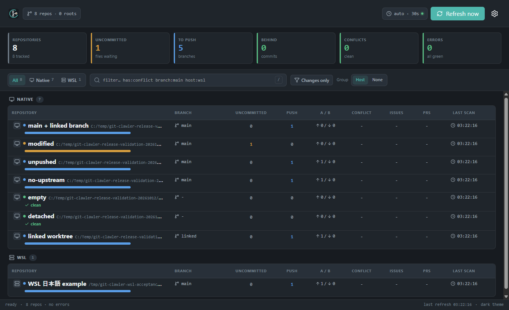

# git-clawler

複数 Git リポジトリの未コミット・未 push を一覧監視します。正本は [英語 README](README.md) です。

対象は Linux x86_64 CLI と Windows 10/11 x86_64 GUI、Windows から WSL の監視です。
[Releases](https://github.com/sahokun/git-clawler/releases) の配布物と SHA256SUMS を取得し、検証してください。
Linux は静的 musl バイナリを実行可能にし、PATH 上へ `gclawl` として配置します。HTTPS fetch はシステムの CA 証明書を使います。
Windows MSI は WebView2 不在時に bootstrapper をダウンロードします。portable は Runtime の別途導入が必要です。
Windows 配布物は未署名です。

CLI は `gclawl scan ~/projects --depth 3 --add` で登録し、`list` / `watch` / `tui` で確認します。
`remove <path>` は設定だけを削除します。GUI は Settings から登録します。Scan Roots は既定で自動追従し、起動時・Refresh・5分ごとに直下のリポジトリと、その linked worktree を自動登録します（worktree は親の下にまとめて表示）。一度だけ登録したいときは Scan を押します。消えたパスは Not found と表示し、自動では削除しません（Git が管理から外した worktree の登録は自動で外れます）。自動登録された項目を削除すると、ルートの exclude に追加されます。
設定は Linux の `~/.config/git-clawler/config.toml`、Windows の `%APPDATA%\git-clawler\config.toml` です。

upstream 未設定ブランチは全コミットを未 push と計上します。ahead/behind と競合予測はローカルの
remote-tracking refs に基づき、鮮度やマージ成功を保証しません。fetch と GitHub 通信は任意です。
GitHub の件数取得は `gh` の導入と認証が必要です。WSL は distro ごとの helper でポーリングします。
WSL コマンドは通常60秒、fetch時120秒でタイムアウトし再試行できます。

構成は core（Git・設定）、cli（CLI/TUI）、gui（Tauri）、wsl-helper（WSL 内処理）です。
1.x の互換性対象は文書化した CLI・TOML・helper プロトコルで、GUI DTO と表の書式は外部 API ではありません。
開発は [CONTRIBUTING](CONTRIBUTING.md)、脆弱性の非公開報告は [SECURITY](SECURITY.md) を参照してください。
MIT ライセンスです。

Windows の通知機能には MSI によるインストールが必要です。単独の portable 版では通知をサポートしません。
