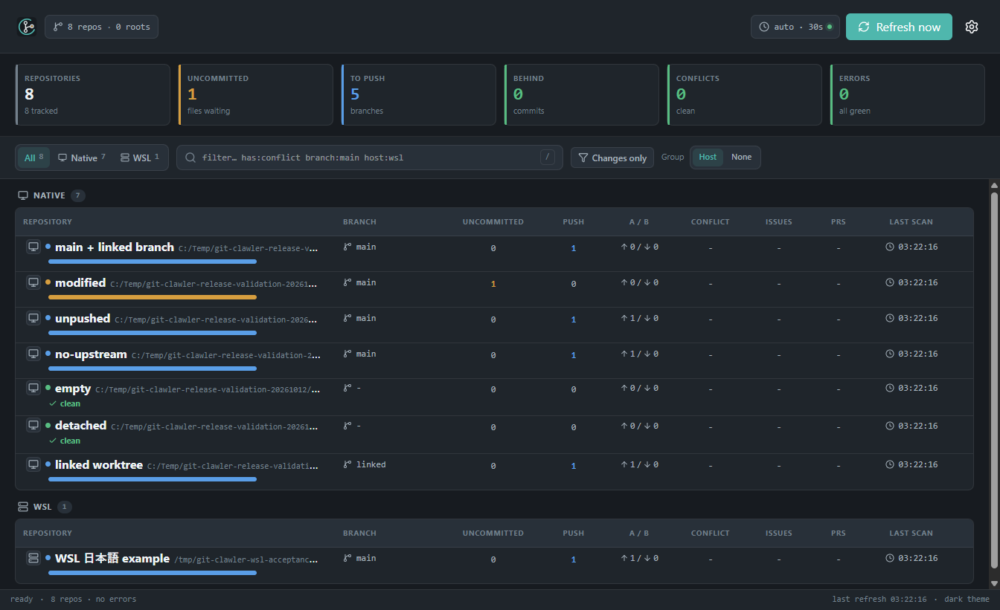

# git-clawler

> A cross-platform Git repository status watcher for Linux, Windows, and WSL.

[日本語版 (Japanese)](README.ja.md)

## Overview

**git-clawler** monitors multiple Git repositories and surfaces uncommitted files and unpushed branches at a glance.

- **Linux**: CLI (`gclawl list|watch|scan|tui|remove`)
- **Windows**: Native GUI (Tauri)
- Windows can also monitor repositories **inside WSL**



## Installation

Releases target Linux x86_64 and Windows 10/11 x86_64.
Download assets and SHA256SUMS from [Releases](https://github.com/sahokun/git-clawler/releases).
Verify the checksum before installation. Linux CLI and WSL helper assets are static musl binaries.
Install the Linux CLI as `gclawl` in a directory on your PATH, for example:

```bash
sha256sum --ignore-missing -c SHA256SUMS
mkdir -p ~/.local/bin
install -m 755 gclawl-v*-linux-x86_64 ~/.local/bin/gclawl
```

Optional HTTPS fetch uses the system CA certificate store.

Windows MSI installs the application and helper and downloads the WebView2 bootstrapper
when the runtime is missing (internet access required). Portable users must install
Microsoft Edge WebView2 Runtime separately and keep the executable and resources together.
Windows packages are unsigned; Windows may display publisher or SmartScreen warnings.

## First registration and configuration

In the Windows GUI, add repositories in Settings > Repositories, or configure
Scan Roots. A scan root with **Auto-follow** (the default) registers repositories
below it automatically at startup, on Refresh and every 5 minutes, together with
their linked worktrees wherever those live; worktrees are listed under their main
repository. Press Scan to register once without auto-follow. On Linux, run
`gclawl scan ~/projects --depth 3 --add`, then `gclawl list`.

Removing an entry never deletes repository files. Removing an entry that an
auto-follow root would find again adds it to that root's `exclude`. A registered
path that no longer exists is shown as **Not found** and is only removed when you
remove it; worktrees that Git no longer tracks are dropped automatically.

Configuration lives at `~/.config/git-clawler/config.toml` on Linux
(or `$XDG_CONFIG_HOME/git-clawler/config.toml`) and
`%APPDATA%\git-clawler\config.toml` on Windows.

```toml
[general]
refresh_interval_secs = 30 # must be greater than zero
fetch_on_refresh = false

[[repositories]]
path = "/home/user/projects/example"
# Windows GUI: set distro for a WSL repository; omit for native paths.
# distro = "Ubuntu"

[[scan_roots]]
path = "/home/user/projects"
depth = 1          # 1 = direct children (default); shared by Scan and auto-follow
auto = true        # register new repositories automatically (default)
worktrees = true   # also register linked worktrees (default)
# Folder names, paths relative to the root, or absolute paths.
exclude = ["archive", "old/app"]
# distro = "Ubuntu" # Windows GUI: WSL root

[github]
enable_issues = false
enable_prs = false
token_env = "GITHUB_TOKEN"

[notifications]
enabled = false
cooldown_secs = 300
```

## Status semantics and compatibility

Branches without upstream configuration count all reachable commits as unpushed.
Ahead/behind and conflict prediction use local remote-tracking refs, which can be stale.
Conflict prediction detects overlapping changed paths; it cannot guarantee whether a merge
will succeed. Fetch is optional and disabled by default. A failed fetch keeps the cached
refs and displays a GUI warning; the CLI writes diagnostics to stderr. Retry after
correcting the connection or authentication problem.

GitHub communication is optional: enable Issues/PRs and install/authenticate `gh`
(or supply a token through the named environment variable). Missing `gh`, authentication
or network failures omit counts. Linux notifications require `notify-send`.
Windows notifications require the MSI installation; standalone portable builds do not support notifications.
WSL uses a bundled one-shot Linux helper, installed per distro, rather than scanning
through Windows network paths. WSL monitoring polls; native repositories also use filesystem events.
WSL commands have a 60-second budget, or 120 seconds for fetch requests, and can be retried.

1.x preserves documented CLI commands and flags, TOML settings, and helper protocol
compatibility as described in the helper README. CLI success returns 0, command/configuration
failures return 1, and argument errors return 2. Per-repository scan errors appear in rows;
a successful list command does not promise all rows succeeded. Table formatting and GUI
internal DTOs are not external APIs. Rust crates are not published to crates.io.

## Features

- Parallel scan of all registered repositories
- Uncommitted file count and unpushed branch detection
- Pull-conflict prediction via remote-tracking refs
- Optional fetch before scan for improved accuracy
- GitHub Issues / PRs column (opt-in via `--with-github`)
- `gclawl remove <path>` removes a repository from the config without deleting files
- GUI Detail panel shows the five newest `HEAD` commits for each repository
- Desktop notifications on status change (configurable)

## Platform Support

| Platform | Mode | Status |
|----------|------|--------|
| Linux (x86_64) | CLI | ✅ Implemented |
| Windows | GUI (Tauri) | ✅ Implemented |
| Windows → WSL repositories | via `wsl-helper` | ✅ Implemented |

## Quick Start

For source builds, see [CONTRIBUTING.md](CONTRIBUTING.md).
The following commands use the installed release binary.

### Run the CLI

```bash
# List all registered repositories
gclawl list

# With GitHub Issues / PRs
gclawl list --with-github

# Interactive watch mode (requires TTY)
gclawl watch

# TUI (ratatui two-column view)
gclawl tui

# Scan a directory for Git repositories and optionally register them
gclawl scan ~/projects --depth 3
gclawl scan ~/projects --depth 3 --add

# Remove one repository from ~/.config/git-clawler/config.toml only
gclawl remove ~/projects/old-repo
```

#### Key bindings (watch / tui)

| Key | Action |
|-----|--------|
| `r` | Manual refresh |
| `q` / `Ctrl-C` | Quit (watch) |
| `q` / `Esc` | Quit in normal TUI mode |
| `Ctrl-C` | Always quit (tui) |
| `j` / `k` / ↑ / ↓ | Move selection (tui) |
| `d` | Remove the selected repository from the config after confirmation (tui) |
| `Enter` / `y` | Confirm repository removal (tui) |
| `Esc` / `n` | Cancel repository removal (tui) |
| `/` | Start filter input (tui) |
| `Backspace` / `Esc` | Delete filter text / clear filter while filtering (tui) |
| `q` / `Esc` | Close help while help is open (tui) |
| `?` | Open/close help (tui) |

### Run the Windows GUI

Install the MSI or extract the complete portable zip from Releases, then launch git-clawler:

- Tray icon shows green / yellow / red for clean / uncommitted / unpushed
- A global shortcut can toggle the window after you set one in Settings
- × button minimises to tray (configurable)
- Conflict and GitHub columns available

## WSL Repository Support

The Windows GUI communicates with the WSL-side `git-clawler-wsl-helper` binary over `wsl.exe`.
See [crates/wsl-helper/README.md](crates/wsl-helper/README.md) for the wire protocol and version compatibility rules.

## Architecture and development

`crates/core` owns configuration, repository discovery and Git status via libgit2.
`crates/cli` provides the Linux CLI/TUI; `crates/gui` provides the Windows Tauri WebView
and OS integration; `crates/wsl-helper` runs the same core logic inside WSL.
Blocking Git operations run on workers, and repositories are scanned concurrently.

See [CONTRIBUTING.md](CONTRIBUTING.md) for builds, checks and PRs targeting main,
and [SECURITY.md](SECURITY.md) for private vulnerability reports.

## License

MIT — [LICENSE](LICENSE). Distribution packages include third-party notices.
